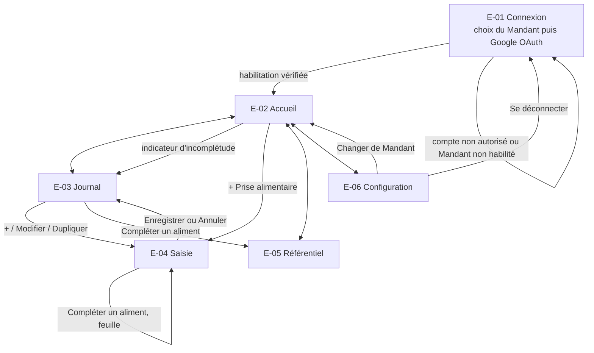

# UX et Parcours — Suivi Nutritionnel Personnel (`docs/03-ux-et-parcours.md`)

## 1. Objet, Sources et Périmètre

Ce document décrit l'**expérience utilisateur** du socle **MVP (Mobile-first)** : l'architecture de navigation, les écrans et leurs zones, les briques d'interface transverses, les **parcours principaux** et les **états d'interface** (chargement, vide, erreur, incomplétude). Il traduit en écrans les fonctionnalités (`F-*`), règles de gestion (`RG-*`) et critères d'acceptation (`CA-*`) de `docs/02-specs-fonctionnelles.md`, sans en créer de nouvelles.

* **Sources** : le rôle de chaque document et leur hiérarchie sont fixés dans `01-vision-produit.md` §5 ; le présent document ne modifie aucune règle de gestion.
* **Terminologie** : tous les libellés d'écran, boutons et messages utilisent exclusivement les termes du dictionnaire (`00-dictionnaire-metier.md`), sans synonyme proscrit.
* **Propositions d'ergonomie** : les choix de présentation qui ne découlent pas directement du 02 sont signalés comme **[Proposition]**. Les arbitrages rendus et les questions qui restent ouvertes sont regroupés en section 10.
* **Périmètre** : celui du MVP (`01-vision-produit.md` §3) ; l'expérience Desktop, hors MVP, est esquissée en section 8.

---

## 2. Principes Directeurs de l'Expérience

* **UX-PRI-01 — Saisie en quelques secondes** : le parcours le plus fréquent (enregistrer une prise alimentaire habituelle) doit tenir en 3 à 4 taps depuis l'ouverture de l'application, grâce à la présélection du type (`RG-TMP-04`), à la copie d'une prise récente (`RG-SUG-01`), aux suggestions (`RG-SUG-02`, `RG-SUG-03`) et aux bases courantes (`RG-REF-06`).
* **UX-PRI-02 — Ne jamais bloquer la saisie** : un aliment absent du référentiel ou dont des valeurs manquent ne bloque rien ; il est créé à la volée comme `Aliment non évalué` (`RG-REF-02`, `RG-REF-05`). Les seuls blocages de validation sont ceux de `F-EDIT-05`.
* **UX-PRI-03 — Contexte de `Mandant` toujours visible** : le `Mandant` actif est affiché en permanence sur tous les écrans authentifiés (`RG-MND-03`), avec une distinction visuelle forte pour `TEST` afin d'éviter toute saisie réelle dans le mauvais contexte.
* **UX-PRI-04 — Transparence de l'incomplétude** : tout total qui intègre un `Aliment non évalué`, un `Élément partiellement évalué` ou un `Élément supprimé` porte le même indicateur visuel d'avertissement, à tous les niveaux (ligne, prise, journée, semaine, période glissante) (`RG-CAL-05`, `F-DASH-04`).
* **UX-PRI-05 — Valeurs absolues et repères choisis** : les `Valeurs nutritionnelles` et `Agrégats nutritionnels` sont affichés en valeurs absolues, arrondies à l'affichage seulement (`RG-CAL-01`). Le seul repère affiché est la `Cible nutritionnelle` définie par l'utilisateur (`RG-CIB-01` à `06`) : position par rapport à une valeur cible ou à une plage cible et écart en unités, sans pourcentage de la cible atteinte ni message de recommandation (`RG-CIB-03`).
* **UX-PRI-06 — Aucune perte silencieuse** : en cas d'erreur réseau, aucune réussite n'est affichée, un message clair est présenté et la saisie reste à l'écran (`F-AUTH-04`, `F-EDIT-05`).
* **UX-PRI-07 — Mobile-first tactile** : une main, pouce en bas d'écran : actions principales en partie basse, cibles tactiles d'au moins 44 × 44 px, clavier numérique pour les grandeurs et portions.

---

## 3. Architecture de Navigation

### 3.1. Carte des écrans

Les identifiants d'écran reprennent les dossiers de `apps/mobile/screens/` définis dans `04-specs-techniques.md` §2.2.

| ID | Écran (dossier) | Fonctionnalités couvertes | Rôle |
| :--- | :--- | :--- | :--- |
| **E-01** | Connexion (`connexion`) | `F-AUTH-01` à `04` | Choix explicite du `Mandant`, connexion Google OAuth, messages d'accès refusé. |
| **E-02** | Accueil (`accueil`) | `F-DASH-01` à `04` | Lecture des `Agrégats nutritionnels` : journée, semaine calendaire, 7 derniers jours. |
| **E-03** | Journal (`journal`) | `F-JRN-01` à `03` | Liste chronologique des prises alimentaires d'une date, détail, actions. |
| **E-04** | Saisie d'une prise alimentaire (`saisie-prise-alimentaire`) | `F-EDIT-01` à `05` | Création, modification et duplication d'une `Prise alimentaire`. |
| **E-05** | Référentiel (`referentiel`) | `F-CAT-01` à `04` | Aliments, recettes, plats préparés, import / export de la table d'aliments. |
| **E-06** | Configuration (`configuration`) | `F-CFG-01` à `03` | Types de prise alimentaire et fenêtres temporelles, bases courantes, compte et `Mandant`. |

Les sous-écrans et feuilles (panneaux glissant depuis le bas de l'écran) sont décrits avec leur écran parent en section 5.

### 3.2. Navigation basse

Une barre de navigation basse fixe, présente sur tous les écrans authentifiés sauf pendant la saisie d'une prise alimentaire (E-04, écran plein focalisé) :

| Position | Onglet | Destination |
| :--- | :--- | :--- |
| 1 | Accueil | E-02 |
| 2 | Journal | E-03 |
| 3 (centrale, mise en avant) | **+ Prise alimentaire** | E-04 en création |
| 4 | Référentiel | E-05 |
| 5 | Configuration | E-06 |

* Le bouton central est l'action principale de l'application : il ouvre directement E-04 avec la date du jour (ou la date affichée lorsque l'utilisateur est sur E-03), l'heure courante et le type présélectionné (`F-EDIT-01`).
* Référentiel et Configuration sont « hors séquence principale » (`02` §4.5, §4.6) : ils restent accessibles mais en périphérie de la barre.

### 3.3. En-tête permanent et bandeau de `Mandant`

* Chaque écran authentifié affiche un en-tête compact : titre de l'écran à gauche, **badge du `Mandant` actif** à droite (`RG-MND-03`, `F-DASH-01`).
* `REAL` : badge discret (texte `REAL`, couleur neutre).
* `TEST` : **[Proposition]** bandeau coloré pleine largeur sous l'en-tête (ex. orange, texte « Mandant TEST — données d'essai »), visible aussi dans E-04, pour qu'une saisie dans `TEST` ne soit jamais confondue avec l'usage réel.
* Un tap sur le badge ouvre la section Compte de E-06 (changement de `Mandant`, `F-CFG-03`).

### 3.4. Séquence des écrans



* Après enregistrement d'une prise alimentaire, l'utilisateur revient sur E-03 positionné sur la date de la prise, la prise enregistrée étant mise en évidence brièvement.
* Après **Annuler** dans E-04, retour à l'écran d'origine (E-02 ou E-03).

### 3.5. Date sélectionnée partagée

**[Proposition]** E-02 (vue Jour) et E-03 partagent une **date sélectionnée** unique (aujourd'hui à l'ouverture de l'application) : naviguer au jour précédent dans l'accueil puis ouvrir le journal affiche le même jour. La date sélectionnée est conservée durant la session (non persistée après rechargement).

### 3.6. Adresses des écrans

**[Proposition]** Routage par fragment d'URL, compatible avec un hébergement statique : `#/connexion`, `#/accueil`, `#/journal/2026-11-24`, `#/saisie-prise-alimentaire` (création), `#/saisie-prise-alimentaire/<id>` (modification), `#/referentiel/aliments`, `#/referentiel/recettes`, `#/referentiel/plats-prepares`, `#/configuration`. Le bouton « retour » du navigateur et du téléphone suit cette navigation. Toute adresse authentifiée ouverte sans session ou sans `Mandant` valide renvoie vers E-01 (`04` §5).

---

## 4. Briques d'Interface Transverses

Ces briques relèvent du `design-system/` (`04` §2.1) et sont réutilisés à l'identique dans tous les écrans.

### 4.1. Indicateur d'incomplétude

* Pictogramme d'avertissement unique (triangle) accompagné d'un texte accessible, affiché à côté de tout total ou de toute ligne concernée (`RG-CAL-05`).
* Texte associé selon la cause, au tap ou en infobulle :
  * « Contient un aliment non évalué » ;
  * « Contient un élément partiellement évalué » ;
  * « Contient un élément supprimé » ;
  * plusieurs causes : liste des causes.
* Sur un agrégat (journée, semaine, période glissante), le tap sur l'indicateur mène au journal concerné (`F-DASH-04`).
* La valeur affichée reste la somme calculée avec les grandeurs manquantes valorisées à `0` (`RG-CAL-04`), jamais masquée.

### 4.2. Badges de statut

| Badge | Porté par | Règle |
| :--- | :--- | :--- |
| `Non évalué` | Aliment | `RG-REF-04` (automatique ou manuel). |
| `Partiellement évalué` | Recette, plat préparé | `RG-CAL-05`. |
| `Élément supprimé` | Ligne d'une prise alimentaire ou d'une recette | `RG-SUP-02` ; libellé en italique, valeur `0`. |
| `Archivé` | Aliment, recette, plat préparé, type de prise alimentaire | Visible seulement lorsque l'affichage des éléments archivés est activé ou dans l'historique. |
| `Base courante` | Aliment | `RG-REF-06`. |
| `Par défaut` | Type de prise alimentaire | `RG-TMP-02`. |

### 4.3. Bloc de valeurs nutritionnelles

* **Format compact** (cartes, lignes) : énergie en `kcal` seule.
* **Format complet** (détail) : les grandeurs dans l'ordre de `RG-REF-01` — Énergie, Glucides (dont sucres), Lipides (dont acides gras saturés), Protéines, Fibres, Sel — avec les sous-grandeurs en retrait. L'index glycémique n'apparaît que sur une ligne d'`Aliment` (jamais sur une recette, un plat préparé, une prise ou un agrégat, `RG-CAL-03`).
* **Arrondis** (`RG-CAL-01`) : entier pour `kcal` et IG, une décimale pour les grammes. Séparateur décimal : virgule.
* **Valeur non renseignée** : affichée `—` (tiret cadratin) dans une fiche d'aliment ou de plat préparé, distincte de `0` (`RG-REF-03`).

### 4.4. Sélecteur de `Portion`

* Brique unique utilisée dans E-04 (ligne de prise) et dans les fiches de recette (poids des aliments).
* **Modes** (`RG-REC-03`) présentés en contrôle segmenté :
  * `Aliment` : `g` uniquement (le contrôle segmenté n'est pas affiché).
  * `Recette` / `Plat préparé` : `%` et `Part` toujours ; `g` présent **uniquement si le `Poids total` est renseigné**, sinon absent (pas grisé) pour éviter toute confusion (`CA-11`).
* **Saisie** : `g` et `%` via pavé numérique décimal ; `Part` via deux champs numérateur / dénominateur (ex. `1` / `4`) avec raccourcis `1/2`, `1/3`, `1/4`. Les valeurs supérieures à 100 % ou à une part entière sont acceptées (ex. `150 %`, `3/2`).
* **Suggestions** (`RG-SUG-03`) : jusqu'à 5 puces de portions au-dessus du champ (ex. `120 g`, `1/4`, `50 %`) ; un tap remplit le mode et la valeur. Pour une `Base courante` sans historique, la première puce est son grammage par défaut.
* **Mode initial** : **[Proposition]** celui de la première portion suggérée ; à défaut, `g` pour un aliment et `Part` pour une recette ou un plat préparé.

### 4.5. Recherche unifiée

* Feuille plein écran avec champ de recherche focalisé et clavier ouvert.
* Résultats mêlant `Aliments`, `Recettes` et `Plats préparés` **actifs** du `Mandant` (éléments archivés exclus, `RG-SUP-02`), chacun précédé d'une icône de nature (aliment / recette / plat préparé) et suivi de ses badges (`Non évalué`, `Partiellement évalué`).
* Correspondance insensible à la casse et aux accents.
* Dernière proposition de la liste, toujours visible dès qu'un texte est saisi : **« Créer l'aliment « <texte saisi> » »** (`RG-REF-02`).
* Utilisée en mode restreint aux `Aliments` dans la fiche de recette (avec l'action « Créer l'aliment », `RG-REF-02`) et dans la configuration des bases courantes (sans création). Un `Plat préparé` ou une `Recette` ne se crée jamais à la volée : uniquement depuis E-05.

### 4.6. Dialogues de confirmation et de suppression

* Toute action destructrice (supprimer une prise, une ligne de recette, un aliment, une recette, un plat préparé, un type) passe par un dialogue qui nomme l'objet et l'impact.
* **Dialogue de suppression d'un élément référencé** (`RG-SUP-01`, `RG-SUP-02`, `CA-09`) :
  * message : « Cet aliment est utilisé dans 12 prises alimentaires et 2 recettes. » ;
  * action recommandée mise en avant : **Archiver** (« Il ne sera plus proposé, l'historique reste intact. ») ;
  * action secondaire en rouge : **Supprimer définitivement** (« Les lignes concernées afficheront « Élément supprimé » et compteront pour 0. »), suivie d'une seconde confirmation ;
  * **Annuler**.
* **Élément non référencé** (`RG-SUP-03`) : simple confirmation « Supprimer définitivement <nom> ? ».

### 4.7. Messages et notifications

* **Notification brève** (bas d'écran, 4 s, sans action bloquante) : confirmation d'enregistrement, éléments ignorés lors d'une copie (`RG-SUG-01`), annulation possible quand elle a un sens.
* **Bandeau d'erreur persistant** (haut du contenu, jusqu'à résolution) : erreur réseau ou Supabase, avec action **Réessayer** (`F-AUTH-04`).
* **Avertissement non bloquant en ligne** : doublon `(Aliment, état)` dans une prise (`RG-REC-04`), état à la pesée manquant, rendement de cuisson non renseigné, etc.
* Les messages sont rédigés en phrases complètes, sans code technique, et n'affichent jamais de réussite tant que l'enregistrement n'est pas confirmé par le serveur.

### 4.8. Barre de grandeur (valeur, « dont » et cible)

Brique utilisée dans E-02 et dans le pied de E-04 pour lire **sur une seule barre** la valeur en cours, sa `Cible nutritionnelle` et, le cas échéant, la sous-grandeur « dont » (`RG-CIB-03`).

```text
Glucides 180 g (dont sucres 35 g)          Cible 220–260 g · sous la plage de 40 g
|█████▓▓▓▓▓▓▓▓▓▓▓▓▓▓▓▓▓▓▓▓▓▓      ░░░░░░░░░░░                |
 └ dont ┘└──── glucides ────┘       └ plage cible ┘
       ▲ cible sucres ≤ 50 g
```

* **Échelle** : de `0` à 1,2 fois la plus grande des valeurs affichées (valeur, borne haute ou valeur cible), afin que la cible reste toujours visible.
* **Remplissage principal** : la valeur de la grandeur (ex. glucides), depuis `0`.
* **Segment « dont »** : pour les glucides (dont sucres) et les lipides (dont acides gras saturés), la sous-grandeur est dessinée à l'intérieur du remplissage, depuis `0`, dans une teinte plus foncée de la même couleur. Il n'y a donc plus de ligne séparée pour les sucres ni pour les acides gras saturés.
* **Cible de la grandeur** : en arrière-plan, une **bande hachurée** entre la valeur basse et la valeur haute pour une plage cible (une plage ouverte va jusqu'au bord de la barre ou part de `0`), ou un **trait vertical** pour une valeur cible.
* **Cible de la sous-grandeur** (ex. sucres ≤ 50 g) : petit repère triangulaire sous la barre (ou fine bande pour une plage), à la même échelle.
* **Couleurs** : **[Proposition]** remplissage neutre (bleu ardoise) dans la plage ou sans cible ; **ambre** lorsque la grandeur est sous ou au-dessus de sa plage ; le segment « dont » passe en ambre foncé lorsque la sous-grandeur est hors de sa propre cible. Pas de rouge ni de vert.
* **Texte** toujours présent au-dessus de la barre, pour ne pas reposer sur la couleur seule : valeur, « dont » entre parenthèses, cible et position (« Dans la plage », « Sous la plage de 40 g », « Au-dessus de la plage de 1,2 g », « −150 kcal par rapport à la cible »).
* **Sans cible** : la barre n'affiche que la valeur et le « dont » ; l'échelle est alors commune aux grandeurs exprimées en grammes de la vue.
* Si l'agrégat comparé est incomplet, l'indicateur d'incomplétude (4.1) accompagne la barre (`RG-CIB-04`).

---

## 5. Écrans Détaillés

### 5.1. E-01 — Connexion (`connexion`)

**Finalité** : entrer dans un `Mandant` explicitement choisi, avec un compte Google autorisé. L'écran n'apparaît qu'à la première connexion sur un appareil, après une déconnexion, ou si la session ou le `Mandant` mémorisé ne sont plus valides : sinon l'application s'ouvre directement sur E-02 dans le dernier `Mandant` utilisé (`RG-MND-02`).

**Contenu** :
1. Nom et icône de l'application.
2. Titre « Choisissez le mandant ».
3. Deux cartes radio de grande taille, **aucune présélectionnée** (`RG-MND-02`, `CA-01`) :
   * `REAL` — « Usage réel » ;
   * `TEST` — « Essais et tests ».
4. Bouton **Se connecter avec Google**, désactivé tant qu'aucun `Mandant` n'est choisi.

**Comportements** :
* Au tap sur le bouton, le `Mandant` choisi est mémorisé (onglet et appareil) puis l'utilisateur est redirigé vers Google (`04` §5).
* Au retour, un indicateur « Vérification de l'accès… » s'affiche pendant le contrôle d'habilitation (`RG-MND-03`).
* Succès : arrivée sur E-02.

**États d'erreur** :
* Compte absent de la liste des utilisateurs autorisés (`RG-USR-02`, `CA-13`) : « Ce compte Google n'est pas autorisé à utiliser l'application. » L'utilisateur est déconnecté et reste sur E-01.
* Compte autorisé mais sans `Habilitation` sur le `Mandant` choisi : « Votre compte n'a pas accès au mandant TEST. Choisissez un autre mandant. » Retour au choix du `Mandant`, aucune sélection.
* Réseau indisponible : bandeau d'erreur et bouton désactivé jusqu'au retour du réseau.

### 5.2. E-02 — Accueil (`accueil`)

**Finalité** : lire en un coup d'œil le détail de ses `Valeurs nutritionnelles` de la journée et leur position par rapport à ses `Cibles nutritionnelles` (`F-DASH-01`, `F-DASH-02`, `RG-CIB-01` à `07`). Aucune gestion de prise alimentaire n'y est proposée, hormis le bouton central de la navigation basse.

**Structure** : la **vue Jour détaillée** est la vue principale, affichée à l'ouverture. Un contrôle segmenté discret en haut de l'écran donne accès aux vues **Semaine** et **7 jours** (`F-DASH-03`), qui restent dans le MVP.

#### 5.2.1. Vue Jour détaillée (`F-DASH-02`, `RG-CIB-03`)
* Navigation de date : `‹` jour précédent, date affichée (« Lundi 24 novembre », « Aujourd'hui » le cas échéant), `›` jour suivant ; un tap sur la date ouvre un calendrier.
* **Carte Énergie** en tête, en grand : total de la journée en `kcal`, indicateur d'incomplétude le cas échéant (`F-DASH-04`), et barre de grandeur (4.8) avec la cible d'énergie si elle existe (ex. « 1 850 kcal · −150 kcal par rapport à la cible de 2 000 kcal »).
* **Une barre de grandeur par grandeur** (4.8), dans l'ordre de `RG-REF-01` : Glucides (avec le segment « dont sucres »), Lipides (avec le segment « dont acides gras saturés »), Protéines, Fibres, Sel. Chaque barre montre à la fois la valeur, la cible éventuelle et la position par rapport à celle-ci.
* Si aucune cible n'est définie, un encart discret propose « Définir mes cibles nutritionnelles » (lien vers 5.6.3). Si une cible relative ne peut pas être calculée pour la journée (aucun `Poids de référence` applicable à cette date, ou cible en pourcentage sans cible d'énergie), la grandeur est affichée sans repère avec la mention « Cible non calculable : poids de référence manquant à cette date » ou « … cible d'énergie manquante » (`RG-CIB-04`, `RG-CIB-06`).
* **[Proposition]** Répartition de l'énergie par `Type de prise alimentaire` du jour (liste simple : icône, libellé, `kcal`), sous les grandeurs.
* Lien « Voir le journal du jour » vers E-03 à la même date.
* **Journée sans prise alimentaire** : valeurs à `0`, mention « Aucune prise alimentaire ce jour », ni indicateur d'incomplétude ni positionnement par rapport aux cibles (`RG-CIB-03`).

#### 5.2.2. Vue Semaine (`F-DASH-03`)
* Navigation : `‹` semaine précédente, « Semaine du 23 au 29 novembre », `›` semaine suivante. La semaine calendaire va du lundi au dimanche.
* Carte principale : **`Moyenne journalière`** de chaque grandeur (calculée sur les seuls jours comportant au moins une prise alimentaire), chacune avec sa barre de grandeur, comme dans la vue Jour (`RG-CIB-03`) ; mention du nombre de jours pris en compte (« Moyenne sur 5 jours avec prises »). L'`Agrégat nutritionnel` total de la semaine est affiché en dessous, sans repère de cible (les cibles sont journalières).
* Liste des 7 jours (lundi à dimanche) : énergie du jour, pastille de position par rapport à la cible d'énergie lorsqu'elle existe, indicateur d'incomplétude par jour ; un jour sans prise affiche `—`. Un tap sur un jour ouvre E-03 à cette date (`F-DASH-04`).
* Si aucune prise n'existe dans la semaine : `Moyenne journalière` affichée `—`, sans positionnement.

#### 5.2.3. Vue 7 jours (`F-DASH-03`)
* Période glissante des 7 derniers jours, se terminant aujourd'hui inclus.
* **Avec une cible d'énergie** : graphique des **écarts à la cible** par jour, en barres verticales de part et d'autre d'une ligne zéro (au-dessus : apport supérieur à la cible ; au-dessous : inférieur). Pour une plage cible, l'écart est mesuré à la borne la plus proche et vaut `0` dans la plage. Le total de chaque jour s'affiche au tap sur la barre.
* **Sans cible d'énergie** : barres verticales de l'énergie (`kcal`) par jour.
* Dans les deux cas, les jours incomplets portent l'indicateur au-dessus de la barre ; un tap sur une barre ouvre E-03 à cette date.
* Sous le graphique : `Moyenne journalière` de chaque grandeur avec sa barre de grandeur, puis `Agrégat nutritionnel` de la période.

### 5.3. E-03 — Journal (`journal`)

**Finalité** : consulter et gérer les prises alimentaires d'une date (`F-JRN-01` à `03`).

**Contenu** :
1. Navigation de date identique à la vue Jour de E-02 (date partagée, 3.5).
2. Rappel compact du total du jour (`kcal` + indicateur d'incomplétude).
3. Liste chronologique des **cartes de prise alimentaire** (`F-JRN-01`) :
   * heure (`08:15`), icône et libellé du `Type de prise alimentaire` ;
   * résumé des éléments : 3 premiers noms puis « +2 » ;
   * énergie de la prise en `kcal` et indicateur d'incomplétude ;
   * menu `⋯` : **Modifier**, **Dupliquer**, **Supprimer** (`F-JRN-03`).
4. Un tap sur la carte la **déplie** (`F-JRN-02`) :
   * une ligne par `Élément de prise alimentaire` : nom (ou « Élément supprimé » en italique), état à la pesée (`Cru` / `Cuit`) pour un aliment cuisinable, `Portion` (« 150 g », « 1/4 », « 50 % »), `Note libre` en sous-titre, énergie, badges ;
   * un tap sur une ligne ouvre une feuille de **détail complet** : bloc de valeurs complet de la portion consommée, IG pour un aliment, et pour un `Aliment non évalué` l'action **Compléter l'aliment** (ouvre la fiche aliment, 5.5.2) ;
   * bloc de valeurs complet de la prise en pied de carte.

**Actions** :
* **Modifier** : ouvre E-04 en modification.
* **Dupliquer** : ouvre E-04 en création, pré-rempli avec les éléments, portions, états et notes libres de la prise d'origine (voir parcours P-08).
* **Supprimer** : confirmation « Supprimer la prise alimentaire de 12:30 (Déjeuner) ? » ; après suppression, notification avec action **Annuler** pendant 4 s **[Proposition]**.
* Bouton central de la navigation basse : nouvelle prise alimentaire à la date affichée par le journal, avec l'heure courante (`F-EDIT-01`).

**État vide** : « Aucune prise alimentaire ce jour » et bouton **Ajouter une prise alimentaire**.

### 5.4. E-04 — Saisie d'une prise alimentaire (`saisie-prise-alimentaire`)

**Finalité** : composer et enregistrer une `Prise alimentaire` en quelques secondes (`F-EDIT-01` à `05`). Écran plein, sans navigation basse.

**Modes** : création (bouton central, journal), modification (`Modifier`), duplication (`Dupliquer`, création pré-remplie).

#### 5.4.1. Zones de l'écran (de haut en bas)

1. **En-tête** : `✕` Annuler, titre « Nouvelle prise alimentaire » ou « Modifier la prise alimentaire », badge du `Mandant`.
2. **Contexte temporel** (`F-EDIT-01`), sur **une seule ligne compacte** de trois sélecteurs :
   * **`Type de prise alimentaire`** (icône + libellé) : ouvre la liste des types non archivés, ordonnés par `Priorité`, le type présélectionné étant marqué (`RG-TMP-04`) ;
   * **heure** (heure courante par défaut) et **date** (aujourd'hui par défaut, ou la date du journal), par sélecteurs natifs ;
   * tant que l'utilisateur n'a pas touché au type, changer l'heure recalcule la présélection (`RG-TMP-04`, `CA-02`, `CA-03`, `CA-12`) ; dès qu'il choisit un type, le type ne change plus automatiquement (`RG-TMP-05`) ;
   * en **modification** d'une prise déjà enregistrée, le type est considéré comme choisi : changer l'heure ne le modifie pas ; en **duplication**, le type est présélectionné selon l'heure comme pour une création (`RG-TMP-04`, `F-JRN-03`).
3. **Accélérateurs** :
   * **Prise vide** (`F-EDIT-02`, `RG-SUG-01`, `CA-08`) : bloc « Reprendre une prise récente » avec les **2 dernières prises du même type** (date, heure, résumé des éléments, `kcal`). Un tap copie tous les éléments, portions, états et notes libres ; si des éléments archivés ou supprimés sont ignorés, une notification l'indique (« 1 élément archivé n'a pas été copié »). Le bloc suit le type sélectionné : changer de type change les 2 propositions. S'il n'existe aucune prise de ce type, le bloc n'est pas affiché.
   * **Prise non vide** (`F-EDIT-03`, `RG-SUG-02`, `CA-07`, `CA-08`) : le bloc précédent laisse place au **carrousel de suggestions** (jusqu'à 5 éléments), dont sont retirés en temps réel les éléments déjà présents dans la prise ; un élément retiré de la prise y réapparaît.
   * **Bases courantes** (`RG-REF-06`) : rangée de puces « Bases » toujours visible (ex. *Huile d'olive 10 g*, *Beurre 5 g*).
   * **Champ de recherche** « Ajouter un aliment, une recette ou un plat préparé » : ouvre la recherche unifiée (4.5).
4. **Liste des lignes** (`Éléments de prise alimentaire`) : nom, énergie, badges, et **directement sur la ligne** deux sélecteurs compacts, `Portion` (ouvre le sélecteur de portion 4.4 avec ses suggestions) et état à la pesée (aliment cuisinable seulement, bascule **Cru** / **Cuit**), puis la `Note libre` en sous-titre ; une icône ⓘ ouvre le détail des valeurs et une icône de corbeille retire la ligne ; avertissement non bloquant en ligne si un même couple `(Aliment, état)` figure deux fois (`RG-REC-04`, `CA-07`) : « Cet aliment figure déjà dans la prise avec le même état. » Un tap sur le nom ouvre la feuille d'élément complète (5.4.2) pour la note libre ou le complément de l'aliment.
5. **Pied fixe** (`F-EDIT-05`) :
   * total de la prise recalculé à chaque modification : `kcal` en grand, glucides / lipides / protéines en petit, indicateur d'incomplétude ; un tap déploie le bloc complet ;
   * **total de la journée avec cette prise** (« Journée : 1 750 kcal ») sur une barre de grandeur (4.8) face à la cible d'énergie si elle existe ; le déploiement montre les barres de toutes les grandeurs de la journée ;
   * bouton **Enregistrer**. S'il est indisponible, une ligne explique pourquoi : « Ajoutez au moins un élément », « Choisissez un type de prise alimentaire », « Choisissez l'état de *Riz* (Cru ou Cuit) ».

#### 5.4.2. Feuille d'élément (ajout ou édition d'une ligne)

Ouverte en choisissant un élément (recherche, suggestion) ou en touchant le nom d'une ligne existante (`F-EDIT-04`) ; la portion et l'état restent aussi modifiables directement sur la ligne (5.4.1) :
* nom de l'élément et badges ; pour un aliment non évalué, lien **Compléter l'aliment** (5.4.4) ;
* **état à la pesée** (aliment cuisinable seulement, `RG-ETAT-02`, `CA-04`) : puces **Cru** / **Cuit**, aucune présélectionnée, choix obligatoire ; aucune puce pour un aliment à état unique. Si l'aliment n'a pas de rendement de cuisson et que **Cuit** est choisi, une aide s'affiche sous les puces : « Rendement de cuisson non renseigné : cette ligne compte pour 0. » avec le lien **Renseigner le rendement** (5.4.4) ;
* **`Portion`** : sélecteur de portion avec suggestions (4.4, `RG-SUG-03`) ;
* **`Note libre`** : champ texte court facultatif, placeholder « ex. poêlé, fait maison » (`RG-ETAT-04`) ;
* aperçu des valeurs de la portion (bloc complet, IG pour un aliment) ;
* boutons **Ajouter** (ou **Mettre à jour**) et, en édition, **Retirer de la prise**.

#### 5.4.3. Ajout rapide d'une base courante

Un tap sur une puce de base courante ajoute directement la ligne avec la première portion suggérée (dernière portion utilisée, sinon grammage par défaut), lorsque l'aliment est à état unique. Si l'aliment est cuisinable, la feuille d'élément s'ouvre pour le choix de l'état à la pesée. La ligne ajoutée reste modifiable.

#### 5.4.4. Création et complément d'aliment à la volée

* **Créer un aliment à la volée** (`RG-REF-02`, `F-EDIT-03`), depuis la recherche unifiée :
  1. nom pré-rempli avec le texte recherché ;
  2. choix obligatoire **« Se cuisine (pesé cru ou cuit) »** ou **« État unique »** (`RG-ETAT-01`) ; pour un aliment qui se cuisine, champ **Rendement de cuisson** facultatif (aide : « Poids cuit ÷ poids cru, ex. 2,5 pour du riz ») ;
  3. section repliée « Renseigner les valeurs nutritionnelles maintenant (facultatif) » avec les 9 grandeurs (intitulée « … aux 100 g cru » pour un aliment qui se cuisine) ;
  4. **Créer et ajouter** : l'aliment est enregistré (statut calculé selon `RG-REF-04`, donc `Aliment non évalué` si des grandeurs manquent) et la feuille d'élément s'ouvre pour la portion.
* **Renseigner le rendement à la volée** (`RG-ETAT-02`, `CA-04`) : feuille courte avec le seul champ **Rendement de cuisson** et une aide de calcul facultative (« Poids cru pesé » et « Poids cuit pesé », le rendement étant calculé automatiquement) ; à l'enregistrement, le rendement est enregistré dans le référentiel, le statut de l'aliment et les totaux de la prise sont recalculés.
* **Compléter l'aliment** (`RG-REF-05`) : ouvre la fiche aliment (5.5.2) en feuille plein écran, sans quitter E-04 ; à la fermeture, les totaux de la prise sont recalculés (`RG-CAL-06`).

#### 5.4.5. Enregistrement, abandon et erreurs

* **Enregistrer** : bouton en état de chargement, interface verrouillée le temps de l'appel ; en cas de succès, retour à E-03 sur la date de la prise et notification « Prise alimentaire enregistrée ».
* **Erreur réseau ou Supabase** (`F-AUTH-04`, `CA-10`) : bandeau d'erreur « La prise alimentaire n'a pas pu être enregistrée. Vérifiez votre connexion puis réessayez. », bouton **Réessayer** ; **tout le contenu saisi reste à l'écran** ; aucune notification de succès.
* **Annuler** avec des modifications non enregistrées : confirmation « Abandonner cette saisie ? Les éléments ajoutés seront perdus. » (aucune saisie n'est conservée après fermeture ou rechargement, `F-EDIT-05`).
* **Session expirée pendant la saisie** (`F-EDIT-05`, exception) : si le renouvellement de la session échoue, un dialogue « Votre session a expiré. Reconnectez-vous pour enregistrer cette prise alimentaire. » propose **Se reconnecter**. La saisie en cours est conservée dans le stockage de l'onglet le temps de la reconnexion Google, puis réaffichée dans E-04 et effacée de ce stockage. Si la reconnexion se fait avec un autre compte ou sur un autre `Mandant`, elle est effacée sans être réaffichée.
* **Modification d'une prise dont le type est archivé** : le type archivé reste affiché et sélectionné, marqué `Archivé` ; il n'est pas proposé pour une nouvelle sélection (`RG-TMP-07`).

### 5.5. E-05 — Référentiel (`referentiel`)

**Structure** : trois onglets en haut d'écran : **Aliments**, **Recettes**, **Plats préparés**. Menu `⋯` : **Importer des aliments**, **Exporter les aliments** (`F-CAT-04`). Bouton `+` flottant pour créer dans l'onglet actif.

#### 5.5.1. Listes (`F-CAT-01`)
* Champ de recherche par nom.
* Filtres en puces :
  * **« Aliments non évalués à compléter »** (onglet Aliments ; compteur affiché, ex. « 4 ») ;
  * **« Afficher les archivés »** (tous les onglets).
* Chaque ligne : icône, nom, badges, et pour un aliment cuisinable la mention « Se cuisine · × 2,5 » (rendement, ou « rendement à renseigner »).
* Un tap ouvre la fiche correspondante.
* **Restauration** (`RG-SUP-04`) : avec le filtre « Afficher les archivés », chaque élément archivé porte le badge `Archivé` et une action **Restaurer** (également présente dans sa fiche). Une notification confirme : « Crème fraîche est de nouveau disponible. »

#### 5.5.2. Fiche aliment (`F-CAT-01`, `RG-REF-*`, `RG-ETAT-*`)
* Nom, icône facultative.
* **Statut** : badge `Évalué` ou `Non évalué` calculé automatiquement (`RG-REF-04`), avec la liste des valeurs manquantes (« Manquent : fibres, IG, rendement de cuisson ») ; interrupteur **« Marquer comme non évalué (estimation à vérifier) »** pour la dérogation manuelle (`CA-05`).
* **Cuisson** : contrôle segmenté **« Se cuisine »** / **« État unique »** (`RG-ETAT-01`). Si l'aliment est utilisé dans une prise alimentaire ou une recette, le contrôle porte un cadenas et ne peut pas être changé ; l'explication s'affiche au tap : « Cet aliment est utilisé dans 3 prises alimentaires. Pour ne plus l'utiliser, archivez-le. » (`RG-ETAT-05`, `CA-14`).
* **Rendement de cuisson** (aliment qui se cuisine seulement) : champ décimal strictement positif, avec l'aide « Poids cuit = poids cru × rendement (ex. riz 2,3 ; lentilles 2,6 ; viande 0,8) » et l'aide de calcul « Poids cru pesé / Poids cuit pesé » ; toujours modifiable, la modification recalculant l'historique (`RG-CAL-06`).
* **Valeurs aux 100 g** : un seul bloc avec les 9 grandeurs de `RG-REF-01`, intitulé « Valeurs aux 100 g (cru) » pour un aliment qui se cuisine et « Valeurs aux 100 g » sinon. Pour un aliment qui se cuisine dont le rendement est renseigné, une colonne en lecture seule affiche à côté les valeurs aux 100 g cuit calculées (valeur crue ÷ rendement). Champ vide = non renseigné (`—`), distinct de `0` (`RG-REF-03`) ; un bouton d'effacement remet un champ à vide. Lorsque les glucides valent `0`, l'IG affiche l'aide « Non requis lorsque les glucides valent 0 ».
* Mention `Base courante` avec son grammage par défaut, si applicable (modifiable dans E-06).
* Actions : **Enregistrer**, **Archiver** / **Supprimer** (dialogue 4.6).

#### 5.5.3. Fiche recette (`F-CAT-02`, `RG-REC-01`)
* Nom.
* Liste des aliments : nom, état à la pesée (`Cru` / `Cuit`, pour un aliment cuisinable, selon `RG-ETAT-02`), poids en grammes ; ajout via la recherche unifiée restreinte aux aliments, avec création d'un aliment à la volée si besoin (5.4.4, `RG-REF-02`) ; une ligne d'aliment supprimé affiche « Élément supprimé ».
* **Poids total net** (facultatif), avec l'aide : « Renseignez-le pour pouvoir saisir une portion en grammes. »
* Valeurs calculées : bloc complet pour la recette entière et, si le poids total net est renseigné, aux 100 g ; pas d'IG ; badge `Partiellement évalué` et liste des aliments en cause le cas échéant (`RG-CAL-05`).
* Actions : **Enregistrer**, **Archiver** / **Supprimer**.

#### 5.5.4. Fiche plat préparé (`F-CAT-03`, `RG-REC-02`)
* Nom.
* **Base des valeurs** : contrôle segmenté **« Aux 100 g »** / **« Pour le plat entier »**.
* **Poids total** : obligatoire avec « Aux 100 g » (enregistrement bloqué avec message sinon), facultatif avec « Pour le plat entier ».
* 8 grandeurs (sans IG), champs vides distincts de `0` ; badge `Partiellement évalué` si une valeur manque.
* Actions : **Enregistrer**, **Archiver** / **Supprimer**.

#### 5.5.5. Import / Export (`F-CAT-04`, `RG-REF-07`)
* **Exporter** : choix du format **JSON** ou **CSV**, puis téléchargement d'un fichier nommé avec le `Mandant` et la date (ex. `aliments-REAL-2026-11-24.json`).
* **Importer** :
  1. sélection d'un fichier JSON ou CSV ;
  2. écran de **prévisualisation** : nombre d'aliments lus, erreurs bloquantes par ligne (format, nom manquant, valeur négative ou non numérique, rendement nul ou négatif, rendement renseigné sur un aliment à état unique, changement du caractère cuisinable d'un aliment déjà utilisé), aliments qui seront `Non évalué` ;
  3. **doublons de nom** : pour chacun, choix **Ignorer**, **Mettre à jour** ou **Créer** ; une action « Appliquer à tous les doublons » évite la saisie répétée ;
  4. **Importer** puis compte-rendu (« 42 créés, 3 mis à jour, 2 ignorés, 5 non évalués »).
* L'import se fait toujours dans le `Mandant` actif, rappelé en tête de l'écran de prévisualisation.

### 5.6. E-06 — Configuration (`configuration`)

Écran en sections empilées.

#### 5.6.1. Types de prise alimentaire (`F-CFG-01`, `RG-TMP-02` à `07`)
* Liste ordonnée par `Priorité` (1 en haut) : icône, libellé, fenêtre temporelle (« 16:00 – 18:00 » ; « 23:00 – 05:00 · traverse minuit »), badge `Par défaut`.
* Réordonnancement par poignée de glisser-déposer, doublée de boutons **Monter** / **Descendre** pour l'accessibilité ; les priorités sont renumérotées automatiquement et restent uniques.
* Fiche d'un type : libellé, icône (sélecteur), heure de début, heure de fin, interrupteur **Type par défaut**. Validation : début et fin identiques refusés (« L'heure de début et l'heure de fin doivent être différentes. ») ; si début > fin, mention « Cette fenêtre traverse minuit » (`RG-TMP-03`).
* Retrait d'un type : **Supprimer** s'il n'est référencé par aucune prise, sinon **Archiver** seulement, avec explication (`RG-TMP-07`, `CA-12`) ; le `Type par défaut` ne peut être ni archivé ni supprimé : « Désignez d'abord un autre type par défaut. »
* Section repliée « Types archivés », chaque type portant une action **Restaurer** : il revient en bas de la liste, avec la priorité la plus basse, et peut ensuite être réordonné (`RG-TMP-07`).

#### 5.6.2. Bases courantes (`F-CFG-02`, `RG-REF-06`)
* Liste des aliments désignés avec leur grammage par défaut, modifiable en ligne ; **Retirer** ; **Ajouter une base courante** via la recherche unifiée restreinte aux aliments actifs.
* L'ordre de la liste est celui des puces dans E-04.

#### 5.6.3. Cibles nutritionnelles (`F-CFG-04`, `RG-CIB-01` à `06`)
* **Poids de référence** en tête de section : valeur applicable aujourd'hui (« 75 kg depuis le 24/11/2026 ») et action **Mettre à jour**. La fiche de mise à jour propose le poids et la **date d'effet**, aujourd'hui par défaut ; choisir une date passée affiche « Les cibles par kg seront recalculées à partir du <date>. » (`RG-CIB-06`). Un lien **Historique** liste les valeurs avec leur date d'effet (modification et suppression possibles).
* Une ligne par grandeur agrégeable (Énergie, Glucides, dont sucres, Lipides, dont acides gras saturés, Protéines, Fibres, Sel), avec la définition et la cible effective du jour : « 2 000 kcal », « 25–35 % de l'énergie · 56–78 g », « 1,6–2 g/kg · 120–150 g », « 25–38 g », « ≤ 5 g », ou « Aucune cible ». L'index glycémique n'apparaît pas.
* Fiche d'une cible :
  * contrôle segmenté **Valeur cible** / **Plage cible** ;
  * base : **Valeur absolue**, **Par kg de poids** ou **% de l'énergie** (ce dernier pour les glucides, sucres, lipides, acides gras saturés et protéines seulement) ;
  * un champ pour la valeur cible, ou deux champs « Valeur basse » et « Valeur haute » dont un seul peut rester vide ;
  * la cible effective du jour est affichée en direct (« soit 120 à 150 g aujourd'hui ») ;
  * l'énergie n'accepte qu'une valeur cible absolue, avec la mention « Sert de référence aux cibles en % de l'énergie. À partir de la V2, la dépense énergétique du jour prendra ce rôle. » ;
  * action **Supprimer la cible**.
* Validation : valeur cible strictement positive ; en plage, au moins une borne, et valeur basse strictement inférieure à la valeur haute (« La valeur basse doit être inférieure à la valeur haute. »).
* Mention sous la liste : « La définition des cibles s'applique à toutes les dates, y compris passées. Un changement de poids s'applique à partir de sa date d'effet. » (`RG-CIB-05`, `RG-CIB-06`).
* **Cibles de départ** (`RG-CIB-07`) : à la première connexion, la liste est déjà remplie avec : lipides 25 à 35 % de l'énergie ; dont acides gras saturés ≤ 8 % de l'énergie ; glucides 35 à 55 % de l'énergie ; dont sucres ≤ 50 g (sucres totaux) ; protéines 1,6 à 2 g/kg ; fibres 25 à 38 g ; sel ≤ 5 g. Tant que la cible d'énergie et le poids de référence ne sont pas saisis, un encart en tête de section invite à les renseigner (« Renseignez votre cible d'énergie et votre poids pour calculer les cibles en % et par kg »). En bas de section, le bouton **Rétablir les cibles de départ** remplace, après confirmation (« Vos cibles de lipides, glucides, protéines, fibres et sel seront remplacées par les valeurs de départ. La cible d'énergie et votre poids ne changent pas. »), les cibles de ces sept grandeurs.

#### 5.6.4. Compte et `Mandant` (`F-CFG-03`, `RG-MND-04`)
* Profil Google connecté (nom, adresse, photo).
* `Mandant` actif.
* **Changer de mandant** : choix du `Mandant` cible (`REAL`, `TEST`), puis confirmation « Passer au mandant TEST ? L'écran sera réinitialisé. » ; l'application rouvre E-02 dans le nouveau `Mandant`, sans nouvelle connexion Google (`RG-MND-04`). Si le compte n'a pas d'habilitation sur le `Mandant` cible, un message l'indique et le `Mandant` actif reste inchangé.
* **Se déconnecter** : la session et le `Mandant` mémorisé sont effacés ; retour à E-01 sans sélection.

---

## 6. Parcours Principaux

Chaque parcours indique les écrans traversés, les règles appliquées et les critères d'acceptation vérifiés.

### P-01 — Première connexion
1. E-01 : l'utilisateur choisit `REAL`, touche **Se connecter avec Google**.
2. Google OAuth, retour, « Vérification de l'accès… ».
3. Compte présent dans la liste : habilitations et types de prise alimentaire initiaux créés (`RG-USR-02`) ; arrivée sur E-02 vue Jour, valeurs à `0`, « Aucune prise alimentaire ce jour ».
4. Réouvertures suivantes de l'application sur cet appareil : arrivée directe sur E-02 dans `REAL`, sans E-01 ni Google (`RG-MND-02`, `F-AUTH-03`).
5. Variante : compte absent de la liste → message d'accès refusé et déconnexion (`CA-13`).

*Critères* : `CA-01`, `CA-13`.

### P-02 — Saisie rapide d'une prise habituelle (copie)
1. E-02 : tap sur **+ Prise alimentaire** à 12:40.
2. E-04 : date du jour, 12:40, *Déjeuner* présélectionné (`RG-TMP-04`) ; bloc « Reprendre une prise récente » avec les 2 derniers déjeuners.
3. Tap sur le déjeuner d'hier : éléments, portions, états et notes copiés ; le bloc laisse place au carrousel de suggestions.
4. Ajustement éventuel d'une portion via ses puces de suggestion.
5. **Enregistrer** → E-03 sur la date du jour, prise mise en évidence.

*Critères* : `CA-02`, `CA-08`. *Visée* : 4 taps sans ajustement (UX-PRI-01).

### P-03 — Composition d'une prise avec recherche et aliment créé à la volée
1. E-04 en création ; prise vide.
2. Tap sur une suggestion du carrousel (après un premier ajout) ou recherche « riz » → choix de *Riz basmati* (aliment qui se cuisine, rendement `2,5`) → choix obligatoire de l'état `Cuit`, portion `150 g` via suggestion → **Ajouter**.
3. Tap sur la puce de base courante *Huile d'olive 10 g* → ligne ajoutée directement.
4. Recherche « sauce satay » → aucun résultat → **Créer l'aliment « sauce satay »** → « État unique », valeurs non renseignées → **Créer et ajouter** → portion `30 g`, note libre « maison ».
5. Pied de l'écran : total recalculé avec indicateur « Contient un aliment non évalué ».
6. **Enregistrer**.

*Critères* : `CA-04`, `CA-05`, `CA-07`.

### P-04 — Compléter un aliment non évalué a posteriori
1. E-02 : le total du jour porte l'indicateur d'incomplétude ; tap sur l'indicateur → E-03 à la date du jour (`F-DASH-04`).
2. Dépli de la prise signalée ; tap sur la ligne *sauce satay* → **Compléter l'aliment**.
3. Fiche aliment : saisie des 9 grandeurs (ou des 8 autres et glucides à `0`) → statut `Évalué`.
4. Retour au journal : avertissement disparu, totaux de la prise, du jour et de la semaine à jour (`RG-CAL-06`).
5. Variante : depuis E-05, filtre **« Aliments non évalués à compléter »**, traitement de la liste un par un.

*Critères* : `CA-05`, `CA-06`.

### P-05 — Consulter sa semaine
1. E-02 → vue **Semaine** : agrégat de la semaine en cours, `Moyenne journalière` sur les jours avec prises, liste des 7 jours.
2. `‹` semaine précédente pour comparer.
3. Un jour porte l'indicateur d'incomplétude → tap → E-03 à cette date.
4. Vue **7 jours** : graphique de l'énergie par jour sur la période glissante.

*Critères* : `CA-06` (mise à jour des agrégats de semaine).

### P-06 — Créer une recette et en consommer une part
1. E-05 → onglet **Recettes** → `+`.
2. Nom « Gâteau au yaourt » ; ajout des aliments avec poids et états ; poids total net laissé vide.
3. **Enregistrer** : valeurs de la recette entière affichées, pas de valeurs aux 100 g.
4. E-04 : recherche « gâteau » → feuille d'élément : modes `%` et `Part` seuls (pas de `g`) → `Part` `1/8` → **Ajouter** → **Enregistrer**.
5. Variante plat préparé : *Lasagnes surgelées* « Pour le plat entier » sans poids total → consommées en `1/2` ; avec « Aux 100 g » et poids total `400 g`, le mode `g` est proposé.
6. Variante : portion `150 %` acceptée.

*Critères* : `CA-11`.

### P-07 — Supprimer un aliment déjà utilisé
1. E-05 → fiche *Crème fraîche* → **Supprimer**.
2. Dialogue : « Cet aliment est utilisé dans 8 prises alimentaires et 1 recette. » (`RG-SUP-01`).
3. **Archiver** : l'aliment disparaît des recherches, suggestions et bases courantes ; l'historique et les agrégats passés sont inchangés.
4. Variante **Supprimer définitivement** (seconde confirmation) : les lignes concernées affichent « Élément supprimé », comptent pour `0`, et les prises, la recette et les agrégats concernés portent l'indicateur d'incomplétude.

*Critères* : `CA-09`.

### P-08 — Dupliquer une prise vers une autre date
1. E-03 (hier) → carte du dîner → `⋯` → **Dupliquer**.
2. E-04 en création, pré-rempli avec les éléments, portions, états et notes libres de la prise d'origine (éléments archivés ou supprimés ignorés avec notification) ; date du jour et heure courante par défaut, modifiables ; type présélectionné selon l'heure choisie (`RG-TMP-04`).
3. Ajustements → **Enregistrer** : une nouvelle prise est créée, l'originale est inchangée.

*Critères* : `F-JRN-03`.

### P-09 — Changer de `Mandant`
1. Tap sur le badge `REAL` → E-06 section Compte → **Changer de mandant** → choix de `TEST` → confirmation.
2. Réinitialisation complète du contexte affiché, sans nouvelle connexion Google.
3. E-02 avec le bandeau `TEST` ; aucune donnée de `REAL` n'est visible. À la réouverture suivante, l'application s'ouvre dans `TEST`, dernier `Mandant` utilisé.

*Critères* : `CA-01`.

### P-10 — Perte de réseau pendant l'enregistrement
1. E-04 : prise composée de 4 éléments ; **Enregistrer**.
2. Échec réseau : bandeau d'erreur, bouton **Réessayer**, les 4 éléments restent à l'écran, aucune notification de succès.
3. Retour du réseau → **Réessayer** → enregistrement et retour à E-03.

*Critères* : `CA-10`.

### P-11 — Définir ses cibles et lire sa journée
1. E-06 → **Cibles nutritionnelles** → Énergie : **Valeur cible** `2 000` kcal ; Lipides : **Plage cible** `25` – `35` **% de l'énergie** (soit 55,6 à 77,8 g) ; Fibres : **Plage cible** `25` – `38` g ; Sel : **Plage cible** avec valeur haute `5` g seule ; Protéines : **Plage cible** `1,6` – `2` **par kg**, avec un poids de référence de `75` kg saisi aujourd'hui (soit 120 à 150 g à partir d'aujourd'hui).
2. E-02 vue Jour : énergie « 1 850 kcal · −150 kcal par rapport à la cible », fibres « 22,4 g · Sous la plage de 2,6 g », sel « 4,8 g · Dans la plage » (aucun écart affiché dans la plage), protéines « 110 g · Sous la plage de 10 g », glucides et sucres lus sur la même barre.
3. Vue Semaine : moyenne journalière de chaque grandeur positionnée par rapport à la moyenne des cibles effectives des jours avec prises ; les jours antérieurs au premier poids de référence n'ont pas de cible de protéines.
4. Le poids passe à `73` kg avec date d'effet aujourd'hui : les cibles de protéines des jours passés ne changent pas. Variante : date d'effet choisie au 1er du mois, les jours depuis cette date sont recalculés.
5. Une journée contenant un aliment non évalué affiche la barre accompagnée de l'indicateur d'incomplétude.

*Critères* : `CA-16`.

---

## 7. États d'Interface Transverses

| État | Présentation | Règles |
| :--- | :--- | :--- |
| **Chargement initial d'un écran** | Squelettes de contenu (formes grises) plutôt qu'un indicateur plein écran ; le badge de `Mandant` est affiché immédiatement. | — |
| **Action en cours** | Bouton concerné en état de chargement et désactivé ; pas de double soumission. | `F-EDIT-05` |
| **Liste vide** | Phrase explicative et action principale (ex. « Aucune recette. Créez votre première recette. »). | — |
| **Erreur réseau / Supabase** | Bandeau persistant avec **Réessayer** ; contenu saisi conservé ; aucune réussite affichée. | `F-AUTH-04`, `CA-10` |
| **Hors connexion à l'ouverture** | Écran « Connexion réseau requise » avec **Réessayer** ; aucune donnée n'est affichée depuis un cache. | `01` §3.3, `04` §1.2 |
| **Session expirée** | Renouvellement silencieux du jeton ; en cas d'échec, message « Votre session a expiré » et retour à E-01 ; une saisie en cours dans E-04 est conservée le temps de la reconnexion (5.4.5). | `F-AUTH-03`, `F-EDIT-05`, `04` §5 |
| **Perte du `Mandant` actif** (aucun `Mandant` mémorisé, ou `Mandant` mémorisé sans habilitation active) | Accès aux données bloqué, retour à E-01 sans sélection, sans repli vers `REAL`. | `RG-MND-02`, `04` §5 |
| **Total incomplet** | Indicateur d'incomplétude (4.1). | `RG-CAL-05` |

**Accessibilité et confort** (`04` §2.1) : thème clair uniquement ; contrastes conformes WCAG AA ; libellés textuels pour toutes les icônes ; navigation au clavier possible ; animations supprimées si `prefers-reduced-motion` ; champs numériques avec `inputmode="decimal"` et acceptation de la virgule ; formats français pour les dates (« lun. 24 nov. ») et heures sur 24 h.

---

## 8. Mobile et Desktop

* **MVP** : seule la PWA mobile (`apps/mobile/`) est livrée. Sur un écran large, elle s'affiche en colonne centrée (largeur maximale ~480 px) sans adaptation spécifique.
* **V2+ (hors MVP)** : l'expérience Desktop (`01` §3.2) reprendra les mêmes écrans en disposition multi-colonnes maître-détail, par exemple :
  * Journal : liste des prises à gauche, détail ou saisie à droite ;
  * Référentiel : liste à gauche, fiche à droite ;
  * Accueil : vues Jour, Semaine et 7 jours visibles simultanément ;
  * raccourcis clavier pour la saisie (recherche, ajout, enregistrement).
* Les briques du `design-system/` et la logique de `shared/` sont communs ; aucune règle de gestion ne diffère entre Mobile et Desktop.

---

## 9. Traçabilité

### 9.1. Fonctionnalités → écrans

| Fonctionnalité | Écran / section |
| :--- | :--- |
| `F-AUTH-01` à `04` | E-01 (5.1), 3.3, 7 |
| `F-DASH-01` à `04` | E-02 (5.2), 4.1, 4.8 |
| `F-JRN-01` à `03` | E-03 (5.3) |
| `F-EDIT-01` à `05` | E-04 (5.4), 4.4, 4.5 |
| `F-CAT-01` à `04` | E-05 (5.5), 4.6 |
| `F-CFG-01` à `04` | E-06 (5.6) |

### 9.2. Critères d'acceptation → parcours

| Critère | Parcours / écran |
| :--- | :--- |
| `CA-01` | P-01, P-09, E-01 |
| `CA-02` | P-02, 5.4.1 |
| `CA-03` | 5.4.1 |
| `CA-04` | P-03, 5.4.2, 5.4.4 |
| `CA-05` | P-03, P-04, 5.5.2 |
| `CA-06` | P-04, P-05 |
| `CA-07` | P-03, 5.4.1 |
| `CA-08` | P-02, 5.4.1 |
| `CA-09` | P-07, 4.6 |
| `CA-10` | P-10, 5.4.5 |
| `CA-11` | P-06, 4.4 |
| `CA-12` | 5.4.1, 5.6.1 |
| `CA-13` | P-01, 5.1 |
| `CA-14` | 5.5.2 |
| `CA-15` | 4.5, 5.4.5, 5.5.1, 5.5.3, 5.6.1 |
| `CA-16` | P-11, 4.8, 5.2, 5.6.3 |
| `CA-17` | 4.4, 5.4.3, 5.5.5 |
| `CA-18` | 4.3 |

---

## 10. Arbitrages UX

### 10.1. Points arbitrés

Validés par Philippe les 24 et 25/11/2026 et reportés dans les documents de référence.

| ID | Question | Décision | Report |
| :--- | :--- | :--- | :--- |
| **Q1** | Présentation de l'accueil. | Vue Jour détaillée en vue principale, chaque grandeur étant située par rapport à une cible nutritionnelle (valeur cible ou plage cible) ; vues Semaine et 7 jours conservées et comparées aux cibles via la moyenne journalière (5.2, 4.8, 5.6.3). | `00` *Cible nutritionnelle* ; `01` §3.1, §3.2 ; `02` `RG-CIB-01` à `06`, `F-DASH-02`, `F-DASH-03`, `F-CFG-04`, `CA-16` ; `04` §3.7 |
| **Q2** | Référentiel et Configuration dans la navigation basse. | Oui, 5 onglets avec le bouton central de saisie (3.2). | — |
| **Q3** | Restauration d'un élément archivé. | Action **Restaurer** sur un aliment, une recette, un plat préparé ou un type archivé (5.5.1, 5.6.1). | `RG-SUP-04`, `RG-TMP-07`, `F-CAT-01` à `03`, `F-CFG-01`, `CA-15` |
| **Q4** | Création à la volée hors saisie d'une prise alimentaire. | Aliment créé à la volée aussi depuis la fiche recette ; jamais de plat préparé ni de recette à la volée dans le MVP (4.5, 5.5.3). | `RG-REF-02`, `F-CAT-02`, `CA-15` |
| **Q5** | Date d'une prise créée depuis le journal d'un autre jour. | La date affichée par le journal, avec l'heure courante (3.2, 5.3). | `F-EDIT-01` |
| **Q6** | Type lors d'une modification d'heure ou d'une duplication. | Prise existante : type conservé. Duplication : présélection selon l'heure (5.4.1, P-08). | `RG-TMP-04`, `F-JRN-03` |
| **Q7** | Session expirée pendant une saisie. | Saisie conservée dans le stockage de l'onglet le temps de la reconnexion, réaffichée seulement pour le même compte et le même `Mandant`, puis effacée (5.4.5). | `F-EDIT-05`, `CA-15` |
| **Q8** | Fin de la vue 7 jours. | Aujourd'hui inclus (5.2.3). | — |
| **Q9** | Ajout direct d'une base courante. | Oui lorsque l'aliment est à état unique ; sinon (aliment cuisinable) ouverture de la feuille d'élément (5.4.3). | — |
| **Q10** | Portée des modifications. | La définition d'une cible s'applique à toutes les dates ; un changement de poids de référence s'applique par défaut à partir du jour même, avec rétroactivité possible par une date d'effet antérieure. | `00` *Poids de référence* ; `RG-CIB-05`, `RG-CIB-06` ; `04` table `poids_reference` |
| **Q11** | Visualisation des cibles. | Une seule barre par grandeur montrant la valeur, la cible et la sous-grandeur « dont » (4.8). | — |
| **Q12** | Bases des cibles. | Valeur absolue (ex. sel), par kg de poids de référence (ex. protéines 1,6 à 2 g/kg) ou en pourcentage de la référence énergétique (ex. lipides 25 à 35 %), la référence énergétique étant la cible d'énergie au MVP et la dépense énergétique du jour en V2. | `00` *Poids de référence*, *Référence énergétique* ; `RG-CIB-02`, `F-CFG-04`, `CA-16` ; `04` §3.7 |
| **Q13** | Cible d'énergie dans le MVP, sans dépense énergétique. | Cible fixe saisie en configuration ; égale à la dépense énergétique du jour à partir de la V2. | `00` *Cible nutritionnelle* ; `RG-CIB-01` |
| **Q14** | Pourcentage de la cible atteinte. | Jamais affiché : écart en unités, et pour une plage uniquement en dehors, par rapport à la borne la plus proche. | `RG-CIB-03` |
| **Q15** | Cible des glucides. | Plage de 35 à 55 % de l'énergie, sans calcul de l'énergie restante après lipides et protéines (5.6.3). | — |
| **Q16** | Cible des sucres. | Cible sur les sucres totaux (« dont sucres »), avec une valeur haute de départ à 50 g, les sucres ajoutés n'étant pas distingués (5.6.3). | — |
| **Q17** | Cibles de départ. | Créées automatiquement à la première connexion, modifiables, avec un bouton « Rétablir les cibles de départ » (5.6.3). | `RG-USR-02`, `RG-CIB-07` ; `04` §3.1, §3.7 |
| **Q18** | Reconnexion à chaque ouverture. | Session conservée sur l'appareil (Google sollicité seulement à la première connexion ou après déconnexion) ; dernier `Mandant` mémorisé et rouvert automatiquement ; changement de `Mandant` depuis E-06 sans nouvelle authentification (validé le 27/11/2026). | `00` *Mandant* ; `01` §3.1 ; `RG-MND-02`, `RG-MND-04`, `F-AUTH-01`, `F-AUTH-03`, `F-CFG-03`, `CA-01` ; `04` §4.1, §5 |
| **R1** | Reprise des maquettes de l'ancienne version. | Repris : ligne de contexte compacte, portion et état modifiables sur la ligne, total de la journée face à la cible dans le pied de la saisie, écarts à la cible dans la vue 7 jours (5.2.3, 5.4.1). Écartés : vocabulaire (*repas*, *ingrédient*), état sur une recette, gestion des prises sur l'accueil, synchronisation Garmin, boutons d'ajout séparés par nature. | — |

### 10.2. Points ouverts

Aucun point ouvert à ce jour.
